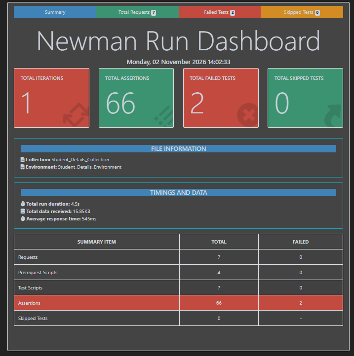

# 🎓 Student Details API Testing with Postman & Newman

Automated API test suite for the [Testing World](https://thetestingworldapi.com) student service, built in Postman and run from the command line with Newman, with an HTML report.



## 📌 Overview

The collection tests a complete student-record workflow (create, update, verify, and build the full profile) across **7 requests and 66 assertions**.

| # | Request | Method | Endpoint | Purpose |
|---|---------|--------|----------|---------|
| 1 | 📋 GetStudent | GET | `/studentsDetails` | List all students |
| 2 | ➕ CreateStudent | POST | `/studentsDetails` | Create a student with randomized data |
| 3 | ✏️ UpdateStudent | PUT | `/studentsDetails/{id}` | Update the student's middle name |
| 4 | 🔍 GetUpdatedStudent | GET | `/studentsDetails/{id}` | Verify the update |
| 5 | 💻 CreateTechnicalSkills | POST | `/technicalskills` | Add technical skills |
| 6 | 🏠 CreateStudentAddress | POST | `/addresses/{id}` | Add address and phone numbers |
| 7 | ✅ FinalStudentDetails | GET | `/FinalStudentDetails/{id}` | Verify the complete profile (21 assertions) |

## ✨ Key Features

- 🎲 **Dynamic test data:** pre-request scripts generate names, date of birth, languages, address and phone numbers using Postman dynamic variables.
- 🔗 **Request chaining:** the student `id` from CreateStudent is saved to the environment and reused by every later request.
- 🔄 **Update verified with a follow-up GET:** the PUT endpoint only returns a success message, so a separate GET request checks that the data actually changed.
- 🛡️ **Data validation against the environment:** every response field is compared with the value that was sent.
- 🧪 **Assertions per request:** status code, response time, response size, status message and response body values.
- 📊 **Reporting:** CLI output plus a shareable HTML report via `newman-reporter-htmlextra`.

## 📁 Project Structure

```
├── Student_Details_Collection.postman_collection.json
├── Student_Details_Environment.postman_environment.json
├── student_report.html
└── screenshots/
    └── newman-report.png
```

## ▶️ Run It

**Prerequisite:** [Node.js](https://nodejs.org)

```bash
npm install -g newman newman-reporter-htmlextra

newman run Student_Details_Collection.postman_collection.json \
  -e Student_Details_Environment.postman_environment.json \
  -r "cli,htmlextra" \
  --reporter-htmlextra-export student_report.html
```

💡 On Windows PowerShell, keep the quotes around `cli,htmlextra` and run the command on one line.

## 📈 Latest Run Results

| 📨 Requests | 🧪 Assertions | ✅ Passed | ❌ Failed | ⏱️ Duration | ⚡ Avg. Response |
|----------|-----------|--------|--------|----------|---------------|
| 7 | 66 | 64 | 2 | 4.5s | 545ms |

All data-validation, response-time and response-size checks pass. The 2 failures are the same finding in two places: `CreateTechnicalSkills` and `CreateStudentAddress` return **200 OK**, while the tests expect **201 Created**. This documents the API's actual behaviour; the expected code in those assertions can be updated to 200.

📄 Open `student_report.html` for the full breakdown.

## 🛠️ Tools

· Postman 
· Newman 
· JavaScript (Chai assertions) 
· Node.js

## 📌 Disclaimer

This is an independent API testing project created for learning and portfolio purposes.

